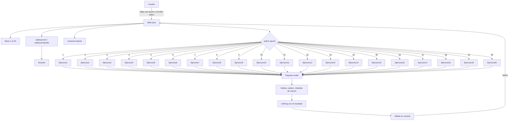

# 20 Ejercicios - Estructuras de Control en Java

Proyecto de consola en Java que resuelve los 20 ejercicios del taller **"Estructuras de Control y Taller de Algoritmia"**. Cada ejercicio está implementado como una clase independiente dentro del paquete `model`, y se ejecuta desde un menú central en `Main`.

## Requisitos

- JDK 27 (el `pom.xml` está configurado con `maven.compiler.source=27` y `maven.compiler.target=27`).
- Maven (opcional) o IntelliJ IDEA.
- Terminal o consola para ejecutar el programa.

## Estructura de carpetas

```text
20Ejercicios/
├── pom.xml
├── README.md
└── src/
    └── main/
        ├── java/
        │   └── uniquindio/edu/co/
        │       ├── Main.java
        │       ├── Presentación y Taller_ Estructuras de Control en Java.pdf
        │       └── model/
        │           ├── Ejercicio1.java
        │           ├── Ejercicio2.java
        │           ├── Ejercicio3.java
        │           ├── Ejercicio4.java
        │           ├── Ejercicio5.java
        │           ├── Ejercicio6.java
        │           ├── Ejercicio7.java
        │           ├── Ejercicio8.java
        │           ├── Ejercicio9.java
        │           ├── Ejercicio10.java
        │           ├── Ejercicio11.java
        │           ├── Ejercicio12.java
        │           ├── Ejercicio13.java
        │           ├── Ejercicio14.java
        │           ├── Ejercicio15.java
        │           ├── Ejercicio16.java
        │           ├── Ejercicio17.java
        │           ├── Ejercicio18.java
        │           ├── Ejercicio19.java
        │           └── Ejercicio20.java
        └── resources/
```

- `Main.java`: contiene el menú, el `Scanner`, las validaciones, el `switch` y el ciclo que permite elegir varios ejercicios.
- `model/`: contiene una clase por ejercicio. Cada clase guarda los datos, realiza los cálculos y genera el reporte con `toString()`.
- `target/`: se genera automáticamente al compilar; no se edita manualmente.

## Cómo funciona la arquitectura

El proyecto separa las responsabilidades así:

1. **Entrada de datos (`Main`)**: el `Main` muestra la lista de ejercicios, lee la opción y solicita los datos necesarios con `Scanner`.
2. **Validación (`Main`)**: todos los datos numéricos se leen con `validacionint(...)` o `validaciondouble(...)`. Si el usuario escribe algo inválido, el programa muestra un mensaje y vuelve a pedir el dato.
3. **Contexto (`Main`)**: al entrar a un ejercicio, se imprime el número, el título y una breve descripción antes de pedir los datos.
4. **Modelo (`model/EjercicioN`)**: cada clase recibe los datos mediante sus métodos `set`, los almacena en atributos `private`, realiza los cálculos con sus propios métodos y construye el resultado en `toString()`.
5. **Salida (`Main`)**: después de llenar el objeto, el `Main` imprime `ejercicio.toString()` en consola.
6. **Repetición**: al terminar, se pregunta `SI/NO` para volver al menú o cerrar el programa.

En otras palabras:

```text
Main (menú y validación) -> EjercicioN (datos y cálculos) -> Main (impresión del resultado)
```

El menú funciona con un `switch`:

```java
switch (numeroejercio) {
    case 1:
        mostrarContexto(1, "LIQUIDACIÓN DE COSECHA CAFETERA",
                "Liquide el pago diario del recolector de café.");
        // Se crea Ejercicio1, se piden sus datos y se imprime
        break;
    case 2:
        mostrarContexto(2, "DIVISIÓN DE CUENTA EN RESTAURANTE CON PROPINA",
                "Divida la cuenta del restaurante entre las personas.");
        // Se crea Ejercicio2, se piden sus datos y se imprime
        break;
    // ...
    default:
        // Opción inválida
        break;
}
```

## Validación de entradas numéricas

El `Main` usa dos métodos auxiliares:

- `validacionint(Scanner scanner, String mensaje)` para datos enteros.
- `validaciondouble(Scanner scanner, String mensaje)` para datos decimales.

Ambos métodos:

1. Imprimen el mensaje recibido.
2. Verifican si el siguiente dato es del tipo esperado.
3. Si es válido, lo devuelven.
4. Si no es válido, descartan la entrada, muestran `Ingrese un numero valido` y vuelven a pedir el dato.

Ejemplo de uso:

```java
int numeroejercio = validacionint(scanner, "Ingrese una opcion: ");
double peso = validaciondouble(scanner, "Ingrese el peso en kilogramos: ");
```

Como el mensaje lo imprime el validador, no se debe escribir un `System.out.print(...)` antes de llamarlo. Después del último dato numérico de cada caso se usa `scanner.nextLine()` para limpiar el salto de línea pendiente.

La validación es únicamente de tipo numérico; no valida rangos como categorías 1 a 4 ni códigos 1/2. El `Main` usa `scanner.useLocale(Locale.US)` para aceptar decimales escritos con punto, por ejemplo `1.70`.

## Contexto de cada ejercicio

Al elegir una opción del menú, el `Main` llama a:

```java
public static void mostrarContexto(int numero, String titulo, String descripcion) {
    System.out.println("\n=== EJERCICIO " + numero + ": " + titulo + " ===");
    System.out.println(descripcion);
    System.out.println();
}
```

Esto permite que el usuario sepa qué ejercicio está resolviendo antes de ingresar los datos.

| Opción | Contexto mostrado |
|---|---|
| 1 | Liquide el pago diario del recolector de café. |
| 2 | Divida la cuenta del restaurante entre las personas. |
| 3 | Convierta los segundos a horas, minutos y segundos. |
| 4 | Calcule el combustible y el costo estimado del viaje. |
| 5 | Verifique el peso del equipaje y aplique el recargo si corresponde. |
| 6 | Evalúe la temperatura del cuarto frío y el riesgo del inventario. |
| 7 | Determine las cajas completas y las baldosas faltantes. |
| 8 | Calcule el pago de horas ordinarias y extras. |
| 9 | Calcule el IMC y clasifique el diagnóstico. |
| 10 | Calcule la factura del acueducto según el consumo. |
| 11 | Calcule la comisión y el pago total del asesor. |
| 12 | Aplique el descuento según el día y el medio de pago. |
| 13 | Evalúe la solicitud de crédito hipotecario. |
| 14 | Clasifique el nivel de triaje del paciente. |
| 15 | Verifique si el aspirante cumple los requisitos. |
| 16 | Determine si el año es bisiesto. |
| 17 | Verifique y clasifique el triángulo. |
| 18 | Calcule el cobro del peaje según la categoría y el telepeaje. |
| 19 | Convierta pesos colombianos a la moneda seleccionada. |
| 20 | Calcule la cotización del plan de gimnasio. |

## Diagrama de conexión con el Main



## Ejercicios implementados

| Opción | Clase | Tema | Tipo de estructura |
|---|---|---|---|
| 1 | `Ejercicio1` | Liquidación de cosecha cafetera | Secuencial |
| 2 | `Ejercicio2` | División de cuenta en restaurante con propina | Secuencial |
| 3 | `Ejercicio3` | Conversor de segundos para renderizado de video | Secuencial |
| 4 | `Ejercicio4` | Presupuesto de combustible para viaje | Secuencial |
| 5 | `Ejercicio5` | Alerta de sobrepeso en equipaje aéreo | Condicional simple |
| 6 | `Ejercicio6` | Control de temperatura en cuarto frío | Condicional doble |
| 7 | `Ejercicio7` | Despacho por cajas cerradas en bodega | Condicional doble con módulo |
| 8 | `Ejercicio8` | Pago de horas extras semanales | Condicional doble |
| 9 | `Ejercicio9` | Clasificación del IMC | Escalera `else if` |
| 10 | `Ejercicio10` | Facturación escalonada de acueducto | Escalera `else if` |
| 11 | `Ejercicio11` | Comisiones de ventas por metas | Escalera `else if` |
| 12 | `Ejercicio12` | Descuento por día de compra y medio de pago | Condicional anidado |
| 13 | `Ejercicio13` | Aprobación de crédito hipotecario | Condicional anidado |
| 14 | `Ejercicio14` | Triaje de urgencias hospitalarias | Condicional anidado |
| 15 | `Ejercicio15` | Convocatoria de beca internacional | Operadores lógicos `&&` y `||` |
| 16 | `Ejercicio16` | Verificación de año bisiesto | Operadores lógicos |
| 17 | `Ejercicio17` | Validador de triángulos | Operadores lógicos |
| 18 | `Ejercicio18` | Peaje vial automatizado por categoría | `switch` |
| 19 | `Ejercicio19` | Casa de cambio internacional | `switch` |
| 20 | `Ejercicio20` | Cotizador de suscripción a gimnasio | Integrador con `switch` y condicionales |

## Cómo se usa el modelo desde el Main

Todos los ejercicios siguen el mismo patrón. Por ejemplo, para el Ejercicio 9:

```java
case 9: {
    mostrarContexto(
            9,
            "CLASIFICACIÓN DEL IMC",
            "Calcule el IMC y clasifique el diagnóstico."
    );

    Ejercicio9 ej9 = new Ejercicio9();

    System.out.print("Ingrese el nombre del deportista: ");
    ej9.setDeportista(scanner.nextLine());

    ej9.setPeso(validaciondouble(scanner, "Ingrese el peso en kilogramos: "));
    ej9.setEstatura(validaciondouble(scanner, "Ingrese la estatura en metros: "));
    scanner.nextLine();

    System.out.println(ej9.toString());
    bandera = seguirocerrar(scanner);
    break;
}
```

La clase `Ejercicio9` se encarga del resto:

```java
public double calcularImc() {
    return peso / (estatura * estatura);
}

public String clasificarImc() {
    double imc = calcularImc();
    if (imc < 18.5) {
        return "Bajo peso";
    } else if (imc < 25.0) {
        return "Peso normal";
    } else if (imc < 30.0) {
        return "Sobrepeso";
    } else {
        return "Obesidad";
    }
}

@Override
public String toString() {
    return "Ejercicio9{" +
            "Paciente='" + deportista + '\'' +
            ", IMC Calculado=" + calcularImc() +
            ", Diagnóstico Médico=" + clasificarImc() +
            '}';
}
```

El flujo completo de una ejecución es:

1. El programa muestra el menú del 1 al 20.
2. El usuario escribe el número del ejercicio.
3. El `Main` muestra el contexto del ejercicio elegido.
4. El `Main` crea el objeto `EjercicioN` correspondiente.
5. El `Main` pide los datos, validando los numéricos, y los guarda usando los `set`.
6. El objeto calcula el resultado cuando se llama a sus métodos o a `toString()`.
7. El `Main` imprime el reporte.
8. El programa pregunta `SI/NO` para continuar.

### Ejemplo de ejecución

Entrada (se incluye un dato inválido a propósito):

```text
9
Camila Soto
abc
78
1.70
NO
```

Salida aproximada:

```text
=== EJERCICIO 9: CLASIFICACIÓN DEL IMC ===
Calcule el IMC y clasifique el diagnóstico.

Ingrese el nombre del deportista: Ingrese el peso en kilogramos:
Ingrese un numero valido

Ingrese el peso en kilogramos:
Ingrese la estatura en metros:
Ejercicio9{Paciente='Camila Soto', Peso=78.0 kg, Estatura=1.7 m, IMC Calculado=26.989619377162633, Diagnóstico Médico=Sobrepeso}
Quieres revisar otro ejercicio: SI/NO
```

## Cómo compilar y ejecutar

### Desde IntelliJ IDEA

1. Abrir la carpeta `20Ejercicios` como proyecto.
2. Verificar que el SDK del proyecto sea JDK 27.
3. Ejecutar la clase `Main`.

### Desde la terminal con `javac`

```bash
mkdir -p target/classes
find src/main/java -name "*.java" -print0 | xargs -0 javac -d target/classes
java -cp target/classes uniquindio.edu.co.Main
```

### Con Maven

```bash
mvn clean compile
java -cp target/classes uniquindio.edu.co.Main
```

## Cómo agregar un nuevo ejercicio

1. Crear una clase nueva en `src/main/java/uniquindio/edu/co/model/`, por ejemplo `Ejercicio21.java`.
2. Declarar sus atributos como `private`.
3. Crear los métodos `get` y `set` para cada dato de entrada.
4. Implementar los métodos de cálculo propios del ejercicio.
5. Sobrescribir `toString()` para devolver el reporte final.
6. Agregar la opción al menú del `Main`.
7. Agregar el nuevo `case` en el `switch` y llamar a `mostrarContexto(...)` al inicio.
8. Leer los datos de texto con `scanner.nextLine()` y los datos numéricos con `validacionint(...)` o `validaciondouble(...)`.
9. Llamar a los `set`, imprimir `toString()` y actualizar `bandera` con `seguirocerrar(scanner)`.

## Notas importantes

- Los datos se leen en el `Main`; las clases del `model` no deberían pedir datos por teclado. La única excepción actual es `Ejercicio2`, que conserva su lógica original para preguntar por la propina.
- El `Main` usa `scanner.useLocale(Locale.US)` para aceptar decimales escritos con punto, por ejemplo `1.70`.
- Los datos numéricos se leen con `validacionint(...)` o `validaciondouble(...)`; no se usa directamente `scanner.nextInt()` ni `scanner.nextDouble()` en los casos de los ejercicios.
- Después del último dato numérico de cada caso se llama a `scanner.nextLine()` para limpiar el salto de línea pendiente.
- Los validadores solo comprueban el tipo de dato, no los rangos permitidos.
- Cada caso muestra su contexto con `mostrarContexto(...)` antes de pedir los datos.
- Los ejercicios del taller no usan ciclos en el modelo; el único ciclo del proyecto es el menú del `Main` para permitir ejecutar varios ejercicios.
- El PDF del taller está ubicado actualmente en `src/main/java/uniquindio/edu/co/` y sirve como referencia de los enunciados.
